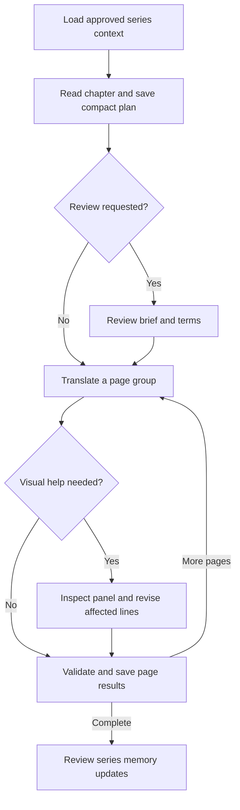

# Booharu: Reducing Translation API Costs

> **Review notes (2026-11-11).** Saved as a reference for issue #125. Nothing here is scheduled or built, and none of it is part of 0.0.4.
>
> - Written against 0.0.3 (`9087cef`). The parser gap in section 2.5 is already closed on `release/booharu-0.0.4`, which rejects missing, repeated and unknown line ids (#67).
> - Section 5.2 (reasoning "off" is sent as `none`, which some newer models may not accept) bears on #124.
> - Suggested scope: phases 1 and 2, plus forwarding reader notes and box notes from phase 3. Decide phases 4 and 5 once real token numbers exist.
> - Prices and outside services' terms were not rechecked.
>
> AI disclosure: this document and these notes were written with AI help, at the request of roorem10.

## Purpose and evidence

This document compiles the discussion about reducing the cost of Japanese-to-English manga translation in Booharu while preserving chapter context, consistent names, character voices, and user review.

**Compiled:** November 10, 2026.  
**Repository:** [roorem10/koharu](https://github.com/roorem10/koharu), branch `booharu`.  
**Code baseline reviewed:** [`9087cef46a84916cf941a584f7bb51c09f37e3c1`](https://github.com/roorem10/koharu/tree/9087cef46a84916cf941a584f7bb51c09f37e3c1).  
**Status:** Research and a proposed design. The recommendations below have not been implemented or benchmarked as part of this review.

Statements marked **current behavior** describe the inspected code. Recommendations, model assignments, and example workflows are proposals. Prices and service terms are a dated snapshot and should be checked again during implementation. No paid inference, translation-quality comparison, latency measurement, or GPU-memory benchmark was performed.

## Contents

1. [Recommended direction](#1-recommended-direction)
2. [What the current program actually sends](#2-what-the-current-program-actually-sends)
3. [Evaluation of the seven original ideas](#3-evaluation-of-the-seven-original-ideas)
4. [Additional options](#4-additional-options)
5. [Model candidates and adapter requirements](#5-model-candidates-and-adapter-requirements)
6. [Proposed chapter workflow and data](#6-proposed-chapter-workflow-and-data)
7. [Token accounting and cost examples](#7-token-accounting-and-cost-examples)
8. [Implementation order](#8-implementation-order)
9. [How to establish actual savings](#9-how-to-establish-actual-savings)
10. [Source map](#10-source-map)

## 1. Recommended direction

The preferred design to build and compare against the existing pipeline is:

**An economical chapter reader, a compact saved chapter plan, an optional review of names and context, translation in groups of three to five pages, and targeted visual assistance for difficult lines.**

The largest early opportunity is to avoid paying again for work that is already complete and valid. Add reliable usage accounting, strict response validation, and resumable saved results before making image-removal decisions. Those foundations make later savings measurable and prevent a cheaper-looking pipeline from silently leaving untranslated text behind.

Then implement the stable prompt layout and translation batching described in [issue #125][issue125]. Give chapter reading its own generation settings and pass useful reading annotations into translation. Finally, compare two ways of avoiding repeated image processing:

- **Visual reading, mostly text translation:** inspect the chapter once, save useful visual observations, and send images to the translator only when needed.
- **Text planning, visual translation:** make the chapter plan from all available source text, then give the translator images for its page groups. This avoids an initial full-chapter visual pass and lets the translating model make visual judgments directly.

Neither arrangement has been demonstrated to be the cheapest or best for this project. The second is an important comparison because a detailed visual reading stage can generate expensive annotations that the translator must then read again.

| Priority | Change | Main reason |
| --- | --- | --- |
| First | Usage accounting, exact response validation, saved results and reading checkpoints | Measure actual spending and prevent avoidable repeated work. |
| Next | Stable request prefix and three-to-five-page translation groups | Reduce repeated chapter instructions and background. |
| Next | Independent reader settings and useful line annotations | Make the separate reader genuinely useful to translation. |
| Compare experimentally | The two image-saving workflows above | Establish the cost and quality tradeoff on real chapters. |
| Add progressively | Reviewed series memory and sourced terminology lookup | Improve consistency across chapters without sending a growing encyclopedia each time. |
| Optional modes | Local reader, combined draft pass, Batch or Flex processing | Support different budgets and turnaround needs. |

## 2. What the current program actually sends

### 2.1 Reading and translation are separate stages

**Current behavior:** chapter reading normally groups up to **20 pages per request**, with a setting from **1 to 40**. It sends the original page images, available source text, linked series information, lettering-category definitions, and the previous reading chunk's summary. Reading images are resized to a maximum longest side of **1,024 pixels**. The reader produces a chapter brief and structured suggestions rather than a complete dialogue translation. [Reading implementation][reader]; [reading settings][read-settings].

**Current behavior:** ordinary translation sends **one request for each eligible page**, containing that page's source segments and translation context. With translation Vision enabled, it also sends the original page, resized to a maximum longest side of **2,048 pixels** and encoded as JPEG at quality **88**. It does not explicitly choose an image `detail` level. [Translation stage][translation-stage]; [translator backend][backend]; [OpenAI adapter][openai-adapter].

For an entirely fresh chapter that runs both remote stages:

```text
Ordinary request count = ceil(scoped reading pages / reader chunk size)
                       + pages with eligible translation segments
```

This excludes retries, manual reruns, and additional optional tasks.

| Example | Reading requests | Translation requests | Total |
| --- | ---: | ---: | ---: |
| 20 eligible pages, reader chunk size 20 | 1 | 20 | 21 |
| 40 eligible pages, reader chunk size 20 | 2 | 40 | 42 |
| Proposed: 20 eligible pages, translation groups of 5 | 1 | 4 | 5 |

The last row is proposed behavior. Changing the reader's pages-per-request setting does not create translation batching. The translation scheduler, output mapping, progress reporting, and saving behavior also need changes.

**Fewer requests do not mean an equivalent percentage reduction in token cost.** Every required translation still needs to be generated, and images, reasoning, failed attempts, and output limits can change the result.

### 2.2 The separate reader setting is only partly independent

The reader can use a different model from the translator, but currently inherits translation generation settings. Reading forces Vision on. Disabling translation Vision does not remove images from chapter reading. Independent reader controls for reasoning, output budget, and sampling are therefore a useful addition. [Reading implementation][reader].

### 2.3 What translation receives from the reader

Current translation hints include:

- Series notes and the chapter summary.
- Characters relevant to the page and their series character notes.
- Glossary entries matching the page's source text, capped at 60, with locked entries preferred.
- Previous source/translation pairs from one page by default, configurable up to two pages.

However, the reader's **per-line notes** and the user's **box notes** are not forwarded to translation. The existing reading result records a line ID, lettering category, confidence, and note. It has no dedicated speaker ID, addressee ID, proposed source-text correction, or visual-uncertainty field. The category confidence is not a validated speaker or translation-confidence score. [Context construction][context]; [pipeline hints][hints]; [chapter data][chapter-data]; [project sidecar][sidecar].

### 2.4 Existing reuse has important limits

A nonempty saved chapter brief suppresses automatic reading. This checks whether a brief exists, not whether the image, source text, model, or selected scope has changed. Automatic reading also depends on other prerequisites, including a linked series, multiple scoped pages, available source text, and an eligible reader. If automatic reading fails, the program logs the failure and proceeds with translation without the new brief. [Reading implementation][reader]; [processing entry point][processing].

Manual chapter reading starts again from the first selected chunk. Results are persisted after all chunks finish; there is no persisted reading checkpoint after each completed chunk. A late failure or cancellation can therefore lose reusable work. Existing translation behavior protects user-authored translations and can skip completed content when resuming. These are useful foundations to preserve. [Reading implementation][reader]; [translation stage][translation-stage].

Reading checks for cancellation between chunks and before committing results. It does not pass the stop token into the active model request, so an already-issued request can still complete and incur usage after Stop. Spending controls must distinguish work already issued from work that has not started. [Reading implementation][reader].

### 2.5 Accounting and validation need attention

The OpenAI response type currently retains generated content but discards the provider's usage metadata. Generic remote tasks return text rather than a result containing both content and usage. [OpenAI adapter][openai-adapter]; [remote task interface][remote-tasks].

The translation parser also initializes output with the original source strings. A missing returned ID can consequently leave Japanese in the result while the resulting vector still has the expected length. It accepts the first valid occurrence of a duplicate ID and ignores out-of-range IDs. Larger batches should not rely on a length check alone. [Translation prompt and parser][prompt].

**Recommended prerequisite:** validate the exact expected ID set before treating a response as successful, saving it as complete, or placing it in a reusable result cache.

## 3. Evaluation of the seven original ideas

### 3.1 Use a cheaper model for reading

**Recommendation: worthwhile, with separate settings and a quality check.**

The reader's model selection already exists, so this is relatively close to the current design. A cheaper vision model may produce adequate scene descriptions and identify recurring names while a more capable translator handles phrasing and ambiguity.

Reading manga is not only listing visible objects. Correctly identifying the speaker, sarcasm, an implied subject, a visual joke, or a suspicious source-text transcription can affect the meaning of later dialogue. A mistaken reading should therefore be recorded as uncertain rather than presented to the translator as authoritative.

Recommended controls:

- Separate reader model, reasoning effort, output budget, and chunk size.
- A concise structured result instead of a long prose report for every page.
- Explicit `unknown` or unresolved states for speakers and interpretations.
- A way for the user or translator to request visual help when the saved plan is insufficient.
- A comparison against a stronger reader on the same difficult pages before setting the cheaper model as the default.

Start by testing an economical reader with a midrange translator. Reserve the most expensive model for cases where review shows a clear benefit. Candidate models and current adapter limitations are in Section 5.

### 3.2 Send smaller or fewer images

**Recommendation: use selective images and readable crops, rather than a universal lower-resolution rule.**

Image billing depends on the selected model and its processing of dimensions and detail, not simply the compressed file's byte count. The current OpenAI guide also warns that `low` detail is not guaranteed to use fewer tokens than `high` for every image/model combination. Small or rotated text can be difficult for vision models. [Images and vision][vision].

The current reader already reduces images to a 1,024-pixel longest side. Reducing that further may be acceptable for scene context while making furigana, names, and small text less legible. Use a readable panel crop when the task requires inspecting text or facial context, and retain a full-page option for layout ambiguity.

**Do not use low source-text count as the only image-selection rule.** A dialogue-heavy page can still require visual context to resolve the speaker, an implied subject, a facial expression, or a joke. Conversely, a nearly silent action page may need only a short scene note.

Proposed signals for requesting an image include:

- Missing, malformed, or conflicting source text.
- A new or unresolved speaker.
- An ambiguous pronoun, referent, tone, or scene transition.
- A sound effect whose interpretation depends on the depicted action.
- A user-marked difficult region.
- A translator's explicit request for visual evidence.

Use a combination of signals. Do not treat a model's self-reported confidence as sufficient proof that a page is safe to translate without images. Compare the total cost of several crops with one full page; cropping is not automatically cheaper.

### 3.3 Reorder requests for caching and count tokens

**Recommendation: a high-priority improvement, already aligned with issue #125.**

OpenAI prompt caching reuses an eligible matching prefix. Its documentation gives a 1,024-visible-token minimum for GPT-5.6 and later; earlier models can vary with request settings. Relevant settings affect matching, and applicable models have distinct cached-read and cache-write rates. Cache-write pricing replaces the ordinary input rate for those tokens rather than adding to it. [Prompt caching][caching].

Proposed request order:

1. Stable system rules, output contract, user instructions, and language pair.
2. Stable approved chapter background and style guidance.
3. Relevant glossary, character information, and previous-page context.
4. Current page and line IDs, source text, and images.

The inspected translation payload puts previous context and glossary ahead of the brief. Its output schema also varies with segment count through `minItems`, `maxItems`, and `id.maximum`; emphasis can change the schema too. [Translation prompt][prompt].

A useful implementation is a **constant, versioned provider schema**, with the exact set of required IDs validated in the application. This improves consistency and may improve cache reuse. The caching benefit is an inference from the provider's documented matching behavior and must be confirmed using actual cached-token usage.

Do not pad prompts to reach a caching threshold. Do not assume a reading request made with one model gives a different translation model a reusable visual state. Reusing an uploaded file ID is also not an exemption from image-processing charges. [Prompt caching][caching]; [Images and vision][vision].

Three concepts should remain distinct:

| Mechanism | What it preserves | Cost implication |
| --- | --- | --- |
| Saved project context | Briefs, terminology, and reviewed annotations | Avoids regenerating context if it remains valid. |
| Application result reuse | A validated result for matching inputs and settings | Can avoid making another model request entirely. |
| Provider prompt caching | An eligible repeated request prefix | Can reduce the cost of input that is still sent. |

[Issue #125][issue125] proposes cache-friendly layout and groups of three to five pages. At the reviewed snapshot, it is planned work, explicitly outside release 0.0.4, without a release assignment. Its savings are not measured results.

### 3.4 Look once in Read chapter, then translate mostly from text

**Recommendation: the preferred first image-saving design to test.**

The reader should produce a compact chapter plan with reusable observations tied to specific pages and lines. The translator then receives the source text, approved terminology, the relevant part of the plan, and visual assistance only for unresolved cases.

Useful fields include speaker, addressee when known, a brief tone cue when it changes the translation, possible source-text mistakes, and specific reasons that visual help may be necessary. The actual source text and user corrections should remain authoritative; model-proposed corrections need provenance and review status.

The current code needs several additions before this works well:

- Forward existing reader line notes and user box notes to translation.
- Add dedicated fields for speaker, uncertainty, and proposed source-text corrections.
- Preserve stable page and line identities across reading and translation.
- Include box geometry or an equivalent region reference for targeted image retrieval.
- Allow the translator or user to escalate an affected line or page to a visual request.

The reader currently receives layer IDs without box geometry. Translation uses request-local numeric IDs. Those representations are adequate for current operations but need an explicit mapping for reusable per-line observations and multi-page translation. [Reading implementation][reader]; [translation stage][translation-stage]; [translation prompt][prompt].

**Keep annotations short.** Producing a long explanation for every bubble increases output costs and creates more input for the translator. Generate observations only when they help interpret the source, and avoid repeating a full visual description in every translation group.

The phrase “look once” should describe the common path, not prevent justified second looks. A bounded fallback should inspect the relevant panel and revise the affected translations without repeating the entire chapter.

### 3.5 Merge reading and translation into one pass

**Recommendation: offer as an optional fast-draft mode, not an assumed cheapest default.**

A combined request can return translations and a small amount of contextual information for the same page group. This eliminates a separate reading call for that group and avoids sending its images to two separate stages.

Tradeoffs:

- The user loses the pause to review the chapter brief and glossary before translation.
- A separate inexpensive reader and stronger translator can no longer divide that request's work.
- Longer outputs can increase the chance of truncation and make failed groups more expensive to repeat.
- If the chapter is split into sequential groups, early groups cannot use pages that have not yet been provided.

However, **if the entire chapter is included in one request, early translations can use information from later pages in that same request**. One-pass generation does not inherently prevent whole-chapter context; the limitation comes from how input is divided. Context, image, and output limits still need to be respected.

A merged request is therefore not automatically the cheapest possible arrangement. Compare it with a cheap or local reader, saved context, and small translation groups using total cost per accepted chapter.

### 3.6 Add series memory

**Recommendation: valuable for consistency, provided updates are reviewed and chapter-aware.**

Booharu already stores series notes, a glossary, and characters, and has context import/export. The useful extension is structured and reviewed memory, not merely adding another large text field. [Series data][series-data]; [context commands][context].

Separate three kinds of information:

| Information | Example | Treatment |
| --- | --- | --- |
| Approved translation decisions | English spelling, honorific policy, character voice | Stable until the user changes it. |
| Story facts known by a chapter | A relationship revealed in chapter 8 | Store first-known chapter and supporting page. |
| Unconfirmed suggestions | A suspected identity or alternate reading | Keep provisional; do not silently promote to fact. |

Reading chapter 12 can begin with concise approved information established through chapter 11. Revisiting chapter 3 should not inject a chapter-12 reveal. Store chapter-aware snapshots or equivalent provenance so relevant historical context can be reconstructed.

Retrieve the small subset needed for the current chapter and page group. Sending the entire accumulated series history with every page could increase costs as a series grows. Lock user-approved terminology so newly generated suggestions do not overwrite it.

After translation, propose a small memory update for review. Avoid letting one speculative chapter summary become a fact repeated across the rest of the series.

### 3.7 Look up series information outside the pages

**Recommendation: initial lookup once per series, followed by targeted updates for genuinely new terms.**

Lookup is most useful for identifying the correct work, finding established English spellings, and providing a short verified premise. A lookup should enrich an approved glossary, not decide translation choices invisibly.

#### Structured database lookup

AniList public metadata queries do not require authentication or an AI model. Its title data distinguishes native, romanized, and English titles. Character-name data includes native, full, and alternate names, but it does **not** provide a dedicated verified-official-English-character-spelling field. Romanization is not automatically an official localization. [AniList authentication][anilist-auth]; [media title fields][anilist-title]; [character name fields][anilist-character].

At the reviewed terms snapshot, noncommercial use is free, and commercial applications/services below $150 monthly revenue can also use the API free; larger commercial use requires a license. The terms restrict bulk collection and backup storage. This refers to the application or service's use and revenue, not an unrelated user's income. Recheck the terms before implementing persistent retrieval. [AniList terms][anilist-terms].

Wikidata can supplement identifiers and aliases; its structured data uses CC0. Coverage should be checked rather than assumed. [Wikidata licensing][wikidata].

#### Search-enabled model

OpenAI and Claude provide explicit web-search tools. Selecting a model alone does not enable web search, and the inspected Booharu OpenAI adapter does not configure it. A lookup feature needs its own tool-enabled integration and spending limits. [OpenAI web search][openai-search]; [Claude web search][claude-search]; [OpenAI adapter][openai-adapter].

Prefer publisher, licensor, or creator sources for official English spellings. Confirm the exact work and edition, including manga versus novel or adaptation. Record the source URL and distinguish official spelling, romanization, and a fan-community preference. Avoid importing full character biographies or spoiler-heavy alternate names into early chapters.

For Google Search grounding, the reviewed Google API terms restrict automated collection, caching, and database uses of Grounded Results, subject to specific exceptions. Do not assume those results can become a permanent series-memory database merely because they can be shown in a research response. [Google API terms][google-terms].

Recommended lookup process:

1. Confirm the correct series and edition.
2. Retrieve basic metadata and candidate names.
3. Verify important English spellings against suitable sources.
4. Present a small set of glossary suggestions with evidence.
5. Let approved existing choices take precedence.
6. Refresh only when a new character, place, edition, or unresolved term warrants it.

## 4. Additional options

### 4.1 Persist reading checkpoints and reuse valid results

Save each successful reading chunk together with its inputs and dependencies. If the process stops after several successful chunks, resume from the first unfinished or invalid chunk.

A proposed result fingerprint should cover:

- Image content, source text, selected regions, and relevant geometry.
- Input page and line IDs, selected scope, and language pair.
- Model identity, generation settings, and image preparation settings.
- Prompt and schema version, user instructions, and relevant context.
- Approved glossary or memory versions that influenced the result.

Avoid invalidating semantic reading merely because an unrelated font or layout setting changed. Conversely, a source-text correction should invalidate affected results. Rolling summaries create dependencies: changing an early reading chunk can invalidate later chunks that consumed its summary.

Store source fingerprints separately from user-edited notes so regeneration does not erase corrections. Keep a clear distinction between “completed,” “needs review,” “failed,” and “stale.”

### 4.2 Use a local chapter reader

The local catalog already includes vision-capable entries such as `gemma4-e2b-it`, `gemma4-e4b-it`, `qwen3.5-2b`, and `qwen3.5-4b`, with image-projector support. These are candidates for a local reader while translation remains on a remote API. [Local model catalog][local-catalog]; [local backend][local-backend].

This removes the hosted reader inference charge; remote translation still costs money, and local processing still uses hardware and time. Their manga comprehension, speed, and GPU-memory use have not been measured here. Do not infer a guaranteed fit or acceptable throughput on a 16 GB card from parameter count alone.

The local entries default to a 1,000-token generation limit unless overridden. That may be insufficient for detailed chapter JSON, particularly for a 20-page chunk. Independent reader output and chunk budgets should be part of this experiment. [Local model catalog][local-catalog].

### 4.3 Use asynchronous Batch processing when turnaround allows

OpenAI's Batch API offers a 50% discount against standard processing with a 24-hour completion window. It processes separate requests, with one model per batch file, and results should be matched by `custom_id` because they can arrive out of order. [Batch API][batch].

This differs from **putting several pages into one translation prompt**. The two approaches can be combined, but they solve different problems.

Reading must finish before translation requests that depend on its results can be constructed. Two dependent batches may therefore require two completion windows. Translation groups that need earlier translations also cannot all be treated as independent jobs without changing their context strategy.

Offer an explicit background or overnight mode, preserve per-page result mapping, and make cancellation/resume behavior clear. Do not assume an entire dependent workflow is guaranteed to finish within one 24-hour window.

### 4.4 Consider Flex processing

OpenAI Flex processing uses discounted rates matching Batch pricing for supported models, with slower responses and possible resource unavailability. The documented Flex `429 Resource Unavailable` response is not charged; that does not imply every kind of failed request is free. [Flex processing][flex].

This may suit users who can wait but prefer a normal request flow. Any automatic fallback to standard pricing should be visible and configurable. Do not present Batch and Flex discounts as two reductions that stack on the same request.

### 4.5 Reuse approved translations carefully

An application translation memory can reuse reviewed renderings of repeated terminology, signs, stock phrases, or identical lines in matching contexts. Begin with exact matches and approved terms before attempting semantic matches.

Identical Japanese text can require different English depending on speaker, referent, politeness, tense, or scene. Store context and approval status. Let the user reject a reuse suggestion rather than silently substituting an inappropriate line.

### 4.6 Escalate only the difficult work

A proposed workflow can use an economical model for routine translation groups and a stronger model for unresolved names, wordplay, unusual source text, or a small number of difficult lines. Escalation should include the needed source, context, and image region, rather than automatically repeating the full chapter.

This introduces a quality-routing problem: missing an ambiguity can be more damaging than spending extra on a known hard line. Start with observable triggers, user flags, and conservative fallback rules. Evaluate the final accepted translation and revision cost, not just the price of the first attempt.

### 4.7 Keep outputs and context concise

Request translations and necessary structured annotations. Avoid default explanations for every line or repeated visual descriptions. Supply relevant glossary and character information rather than all historical notes.

Reduce reasoning effort where the chosen model supports it and a comparison shows no meaningful quality loss. Reasoning tokens are billed as output and consume the output budget, even when they are not shown as translated text. They are part of the reported output total, not an extra total to add again. [Reasoning guide][reasoning].

## 5. Model candidates and adapter requirements

### 5.1 Candidate remote configurations

The following are **candidates to evaluate**, not a benchmark-based Japanese-to-English quality ranking. The current official model pages list image input and reasoning support for these models. [Luna][luna]; [Terra][terra]; [Sol][sol]; [Astra][astra].

| Model ID | Suggested experimental role | Standard short-context input per 1M tokens | Standard short-context output per 1M tokens |
| --- | --- | ---: | ---: |
| `gpt-6-luna` | Economical reader or routine first pass | $0.10 | $0.50 |
| `gpt-6.1-terra` | Intermediate reader/translator comparison | $1.00 | $5.00 |
| `gpt-6.1-sol` | Main translation candidate | $2.00 | $10.00 |
| `gpt-6-astra` | Difficult material or selective high-budget review | $10.00 | $50.00 |

Prices are the reviewed standard short-context rates; cached input, cache writes, long context, and discounted service tiers can differ. [OpenAI pricing][pricing].

An initial comparison could use Luna for reading and Sol for translation, then compare Terra and selective Astra escalation. This is a budget-oriented experiment, not evidence that one model produces superior manga translations.

For IDs that pass the current application's name filter, `gpt-5.4-mini` and `gpt-5.6-sol` are additional image-and-reasoning candidates. Passing that filter does not establish full compatibility or account access. [GPT-5.4 mini][mini54]; [GPT-5.6 Sol][sol56]; [OpenAI adapter][openai-adapter].

### 5.2 The current OpenAI adapter needs model-aware behavior

The inspected adapter uses `/v1/chat/completions`. Its model-discovery filter recognizes selected GPT-5, GPT-4.1, GPT-4o, and o3 names, but excludes GPT-6 IDs. It then marks accepted models as supporting both vision and reasoning. That hardcoded capability assignment should not be used as evidence of actual model support. [OpenAI adapter][openai-adapter].

It maps the existing reasoning toggle to `medium` when enabled and `none` when disabled. Current Sol and Astra documentation lists reasoning efforts beginning at `low`; Terra and Luna also allow `none`. A universal off-to-`none` mapping is therefore unsuitable. [Sol][sol]; [Astra][astra]; [Terra][terra]; [Luna][luna].

Recommended adapter work:

- Discover and retain supported model IDs without relying on a stale family list.
- Track image support and allowed reasoning settings per model.
- Omit or translate unsupported generation parameters deliberately.
- Retain usage metadata, provider request IDs, and finish status.
- Check structured-output support and provider limits.
- Keep web search as an explicit feature with its own configuration.

An OpenAI-compatible endpoint is not an automatic workaround. Compatibility of the URL shape does not guarantee identical vision handling, reasoning parameters, strict schemas, usage fields, or billing.

## 6. Proposed chapter workflow and data

### 6.1 Processing flow



This is a proposed flow. The text-planning/visual-translation alternative should be tested alongside it before selecting a default.

### 6.2 Suggested compact reading record

The following example is an illustrative data contract, not an existing Booharu schema:

```json
{
  "schema_version": 1,
  "chapter_id": "chapter-012",
  "source_fingerprint": "computed-from-relevant-inputs",
  "summary": "A short account of events needed to interpret this chapter.",
  "lines": [
    {
      "page_id": "page-003",
      "line_id": "line-017",
      "speaker_id": "character-a",
      "addressee_id": null,
      "tone": "sarcastic",
      "source_correction_suggestion": null,
      "visual_help_reasons": ["speaker_assignment_uncertain"],
      "region_id": "panel-02",
      "review_status": "suggested"
    }
  ],
  "glossary_suggestions": [],
  "unresolved_questions": []
}
```

Use `null` or an explicit unknown value when evidence is insufficient. Store region geometry with the page and reference it from the record. Keep the original source text and user corrections separate from model suggestions.

Only include semantic cues when they matter. Do not require repetitive tone descriptions for every ordinary line. Short page-level information can cover a whole conversation, with line-level overrides for exceptions.

### 6.3 Exact output validation

Before committing a translation group:

1. Confirm every expected line ID appears exactly once.
2. Reject missing, duplicate, and unknown IDs.
3. Check required fields and the response's completion status.
4. Recheck source fingerprints, relevant context, and current user edits before applying returned or cached results. Do not apply stale responses to changed or deleted lines; retain unaffected validated results for reuse.
5. Map results back to the correct pages without relying on output order.
6. Preserve user-authored translations, exclusions, and locked terminology.
7. Save only results accepted by the validation policy.

Use short request aliases if necessary, with a reliable mapping to persistent page/line IDs. The provider schema can stay stable while the client enforces the exact ID set for that request.

A proposed bounded recovery policy can attempt a limited repair, then split a failed group or request targeted visual help. Surface unresolved failure instead of marking source text as successfully translated. Avoid unbounded retries.

### 6.4 Preserve user control

Batching must preserve selected pages, selected lines, excluded text, existing edits, progress, stop, and resume. Successful validated pages should not be paid for again merely because another group fails.

For sound effects, preserve the user's treatment policy, including retaining original Japanese artwork and placing a small English rendering nearby where requested. A translation-cost optimization should not silently change how those elements are handled.

## 7. Token accounting and cost examples

### 7.1 Record actual provider usage

Introduce a response envelope and an attempt ledger. Capture usage as soon as a provider response arrives, **before** parsing and validation, so invalid-but-billed outputs are included.

| Field | Purpose |
| --- | --- |
| Stage and operation ID | Distinguish reading, translation, lookup, repair, and visual fallback. |
| Provider, model, and service tier | Select the appropriate price schedule. |
| Page/line scope and attempt number | Attribute retries and revisions to the work that caused them. |
| Total input and cached-input details | Measure repetition and cache effectiveness. |
| Cache-write details, when exposed | Avoid mispricing newly cached input. |
| Total output and reasoning subset | Include internal reasoning without double-counting it. |
| Provider request ID, status, and finish reason | Diagnose failures and reconcile usage. |
| Estimated cost and pricing version | Make calculations reproducible. |
| Outcome and latency | Compare cost per accepted result and turnaround. |

A missing usage report should remain **unknown**, not be displayed as zero. Label image-token estimates as estimates if the provider does not expose a separate image breakdown.

For a provider that exposes the relevant categories:

```text
Estimated cost = uncached input tokens × uncached input rate
               + cached-read tokens × cached-read rate
               + cache-write tokens × applicable write rate
               + output tokens × output rate
               + applicable tool charges
```

Use mutually exclusive input categories. Apply rates per million tokens where appropriate. Provider usage and invoices remain the source of truth; the application should not fabricate precision from incomplete metadata.

### 7.2 Repeated-context example

**Hypothetical arithmetic, not a measured chapter:** suppose each translation request repeats 2,000 tokens of shared instructions and background.

| Translation shape | Repeated shared input |
| --- | ---: |
| 20 individual page requests | 20 × 2,000 = 40,000 tokens |
| 4 groups of 5 pages | 4 × 2,000 = 8,000 tokens |
| Difference | 32,000 fewer repeated input tokens |

This says nothing by itself about an 80% reduction in the whole bill. Source text, images, output, reasoning, cache pricing, and retries still contribute.

### 7.3 Image savings can be outweighed by annotations

Using the reviewed ordinary Sol rates as an illustration:

- Avoiding 10,000 billed image-input tokens saves **$0.02**.
- Generating 3,000 additional annotation or reasoning tokens costs **$0.03**.
- That combination costs **$0.01 more**, even before sending the new annotations to the translator.

The token quantities are invented solely to illustrate the tradeoff. They are not typical page costs or a measurement of Booharu. [Rate source][pricing].

The useful target is **cost per accepted translation**, including any extra review and retry work. Minimizing image count or HTTP request count alone can choose the wrong design.

### 7.4 Conversations and file handles do not create free memory

An uploaded image identifier avoids resending the binary payload; it does not make model processing free. Likewise, OpenAI documents that prior inputs remain billable when using `previous_response_id`. Retaining state can simplify a workflow, but it is not a substitute for prompt caching or application-level result reuse. [Images and vision][vision]; [conversation state][conversation-state].

## 8. Implementation order

### Phase 1: Make spending and success observable

- Retain provider usage and request metadata.
- Record every paid attempt, including invalid output and fallback.
- Add exact-ID validation before marking translation complete.
- Persist reading chunks and validated translation results.
- Add dependency-aware freshness checks and preserve user edits.

**Exit condition:** a run can be inspected, stopped, and resumed without silently losing completed work or accepting missing translations.

### Phase 2: Reduce repeated translation context

- Implement the stable prompt layout described in #125.
- Use a stable versioned schema with client-side ID validation.
- Add translation groups of three to five pages within provider limits.
- Preserve page-level progress, scope, stop, resume, and saving.
- Use a bounded failure policy rather than retrying indefinitely.

**Exit condition:** the existing feature set remains available, and measured usage shows what grouping and prefix reuse actually save. #125 references stricter validation work such as #67; those plans should not be described as already implemented. [Issue #125][issue125].

### Phase 3: Improve the reader-to-translator handoff

- Add independent reader generation settings.
- Forward existing reader notes and user box notes.
- Add compact speaker/ambiguity/source-correction fields and region references.
- Preserve approved terminology and review status.
- Adjust reader chunk and output budgets, including local-model defaults.

**Exit condition:** the translator receives the useful observations the reader produced, without a large repetitive annotation burden.

### Phase 4: Compare image-saving modes

- Test visual reading followed by mostly text translation and targeted fallback.
- Test source-text planning followed by visual translation groups.
- Compare with the existing full visual workflow.
- Keep combined reading/translation as a separately evaluated draft mode.

**Exit condition:** choose a default based on accepted quality, total usage, and user correction time.

### Phase 5: Add persistent knowledge and optional processing modes

- Add reviewed, chapter-aware series memory.
- Add a small initial metadata lookup and targeted new-term refresh.
- Preserve source URLs, official-versus-provisional status, and existing choices.
- Offer local reading and eligible discounted processing modes.
- Add carefully scoped reuse of approved translations.

**Exit condition:** later chapters reuse validated knowledge while maintaining the correct historical context and keeping requests compact.

## 9. How to establish actual savings

Use a fixed representative sample of chapters or page groups. Include ordinary dialogue, several speakers, names introduced late, source-text errors, small text, sound effects, visual jokes, and action-heavy pages. Use the same source text, approved glossary, instructions, and review standard for each candidate.

| Comparison | Question it answers |
| --- | --- |
| Current pipeline versus page grouping | Does reduced repetition outweigh larger-output and retry costs? |
| Economical versus stronger reader | Which interpretation errors matter to final translation? |
| Visual reader/text translation versus text plan/visual translation | Which stage most benefits from seeing images? |
| Full-page versus targeted visual fallback | Does selective help preserve meaning at lower total cost? |
| Remote versus local reader | Is local quality and turnaround acceptable? |
| Separate versus combined reading/translation | Is the draft-mode simplification worth the review tradeoff? |

Record total input, cached input, output, reasoning, attempts, latency, and estimated/provider-reported cost. Have a reviewer assess omitted lines, meaning, speaker attribution, name consistency, natural English, and manual correction time. Where practical, hide model labels during review.

Check concrete failure cases before enabling batching broadly: missing or duplicate IDs, truncated output, a stop between groups, resume after a completed chunk, a changed source line, a changed glossary choice, a provider limit, and a user-edited translation.

Do not announce a percentage saving until measured on the same workload. Do not select a default solely because its first request is cheaper. A mode that needs more human correction or repeated model repair can be worse overall.

## 10. Source map

### Booharu code and planned work

All code links below are pinned to the reviewed commit. Issue links are live and may change.

- [Chapter reading implementation][reader] and [reader settings][read-settings].
- [Processing entry point][processing] and [translation pipeline stage][translation-stage].
- [Context construction][context] and [translation hints][hints].
- [Translation backend][backend], [remote task interface][remote-tasks], [prompt/schema/parser][prompt], and [OpenAI adapter][openai-adapter].
- [Chapter data][chapter-data], [series data][series-data], and [project sidecar][sidecar].
- [Local model catalog][local-catalog] and [local backend][local-backend].
- [Issue #125: cache-friendly layout and several pages per request][issue125].

### OpenAI documentation

- [API pricing][pricing], [prompt caching][caching], and [reasoning][reasoning].
- [Images and vision][vision] and [conversation state][conversation-state].
- [Batch API][batch], [Flex processing][flex], and [web search][openai-search].
- [GPT-6 Luna][luna], [GPT-6.1 Terra][terra], [GPT-6.1 Sol][sol], and [GPT-6 Astra][astra].
- [GPT-5.4 mini][mini54] and [GPT-5.6 Sol][sol56].

### External series data and search services

- [AniList authentication][anilist-auth], [title fields][anilist-title], [character-name fields][anilist-character], and [terms][anilist-terms].
- [Wikidata licensing][wikidata].
- [Claude web-search integration][claude-search].
- [Google API terms, including Search grounding conditions][google-terms].

[reader]: https://github.com/roorem10/koharu/blob/9087cef46a84916cf941a584f7bb51c09f37e3c1/crates/koharu-app/src/commands/context/reading.rs
[read-settings]: https://github.com/roorem10/koharu/blob/9087cef46a84916cf941a584f7bb51c09f37e3c1/crates/koharu-app/src/commands/context/settings.rs
[processing]: https://github.com/roorem10/koharu/blob/9087cef46a84916cf941a584f7bb51c09f37e3c1/crates/koharu-app/src/commands/processing.rs
[translation-stage]: https://github.com/roorem10/koharu/blob/9087cef46a84916cf941a584f7bb51c09f37e3c1/crates/koharu-pipeline/src/stages/translation.rs
[context]: https://github.com/roorem10/koharu/blob/9087cef46a84916cf941a584f7bb51c09f37e3c1/crates/koharu-app/src/commands/context.rs
[hints]: https://github.com/roorem10/koharu/blob/9087cef46a84916cf941a584f7bb51c09f37e3c1/crates/koharu-pipeline/src/hints.rs
[backend]: https://github.com/roorem10/koharu/blob/9087cef46a84916cf941a584f7bb51c09f37e3c1/crates/koharu-translator/src/backend.rs
[remote-tasks]: https://github.com/roorem10/koharu/blob/9087cef46a84916cf941a584f7bb51c09f37e3c1/crates/koharu-translator/src/remote/mod.rs
[prompt]: https://github.com/roorem10/koharu/blob/9087cef46a84916cf941a584f7bb51c09f37e3c1/crates/koharu-translator/src/prompt.rs
[openai-adapter]: https://github.com/roorem10/koharu/blob/9087cef46a84916cf941a584f7bb51c09f37e3c1/crates/koharu-translator/src/remote/openai.rs
[chapter-data]: https://github.com/roorem10/koharu/blob/9087cef46a84916cf941a584f7bb51c09f37e3c1/crates/booharu-context/src/chapter.rs
[series-data]: https://github.com/roorem10/koharu/blob/9087cef46a84916cf941a584f7bb51c09f37e3c1/crates/booharu-context/src/series.rs
[sidecar]: https://github.com/roorem10/koharu/blob/9087cef46a84916cf941a584f7bb51c09f37e3c1/crates/booharu-context/src/sidecar.rs
[local-catalog]: https://github.com/roorem10/koharu/blob/9087cef46a84916cf941a584f7bb51c09f37e3c1/crates/koharu-translator/src/local/catalog.rs
[local-backend]: https://github.com/roorem10/koharu/blob/9087cef46a84916cf941a584f7bb51c09f37e3c1/crates/koharu-translator/src/local/mod.rs
[issue125]: https://github.com/roorem10/koharu/issues/125
[pricing]: https://developers.openai.com/api/docs/pricing
[caching]: https://developers.openai.com/api/docs/guides/prompt-caching
[vision]: https://developers.openai.com/api/docs/guides/images-vision
[reasoning]: https://developers.openai.com/api/docs/guides/reasoning
[conversation-state]: https://developers.openai.com/api/docs/guides/conversation-state
[batch]: https://developers.openai.com/api/docs/guides/batch
[flex]: https://developers.openai.com/api/docs/guides/flex-processing
[openai-search]: https://developers.openai.com/api/docs/guides/tools-web-search
[luna]: https://developers.openai.com/api/docs/models/gpt-6-luna
[terra]: https://developers.openai.com/api/docs/models/gpt-6.1-terra
[sol]: https://developers.openai.com/api/docs/models/gpt-6.1-sol
[astra]: https://developers.openai.com/api/docs/models/gpt-6-astra
[mini54]: https://developers.openai.com/api/docs/models/gpt-5.4-mini
[sol56]: https://developers.openai.com/api/docs/models/gpt-5.6-sol
[anilist-auth]: https://github.com/AniList/docs/blob/master/docs/guide/auth/index.md
[anilist-title]: https://github.com/AniList/docs/blob/master/docs/reference/object/mediatitle.md
[anilist-character]: https://github.com/AniList/docs/blob/master/docs/reference/object/charactername.md
[anilist-terms]: https://github.com/AniList/docs/blob/master/docs/guide/terms-of-use.md
[wikidata]: https://www.wikidata.org/wiki/Wikidata:Licensing
[claude-search]: https://platform.claude.com/docs/en/agents-and-tools/tool-use/web-search-tool
[google-terms]: https://aistudio.google.com/docs/terms
